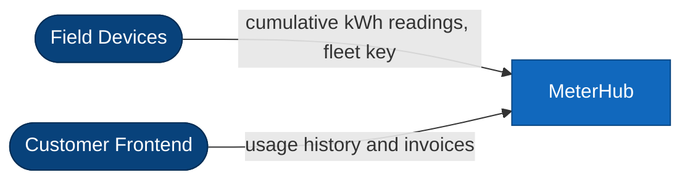
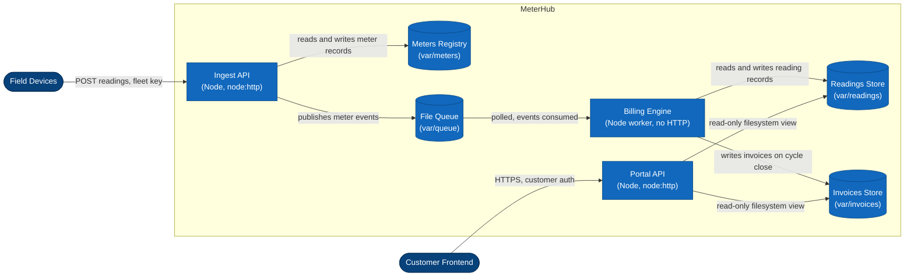

# Architecture: MeterHub

## 1. Overview

MeterHub is three Node services and one shared library in a single repository. There are no npm dependencies and no external infrastructure: persistence is file-backed JSON, and meter events travel between the services via the shared file queue. All state directories default to `var/` and are relocatable through `METERHUB_*` environment variables defined in `packages/core/src/config.js`.

## 2. Components

| Component      | Path                       | Kind              | Owns                                       |
| -------------- | -------------------------- | ----------------- | ------------------------------------------ |
| ingest-api     | `services/ingest-api/`     | HTTP service      | Meters registry (`var/meters/`)            |
| billing-engine | `services/billing-engine/` | Background worker | Readings store and invoices store          |
| portal-api     | `services/portal-api/`     | HTTP service      | No store (reads billing data)              |
| core           | `packages/core/`           | Shared library    | Models, validation, config, queue, helpers |

## 3. Ingest API

The ingest API is the only surface field devices touch. Devices authenticate with a fleet key and submit cumulative kWh register readings. Each reading is validated against the meter registry — the meter must exist and be active — and normalized into the shared Reading model before it is accepted with a 202. The ingest API deliberately keeps no reading data: the meters registry under `var/meters/` is the only store it owns. Meter registration and decommissioning are announced as meter lifecycle events.

## 4. Billing Engine

The billing engine is a background worker with no HTTP surface. It records accepted readings in the readings store (`var/readings/`) and, on cycle close, computes each meter's usage by differencing cumulative register values across the billing window, prices the total against the tariff rate table, and writes one invoice per customer per cycle into the invoices store (`var/invoices/`). Both stores are owned exclusively by the billing engine. Per-customer rate tables were folded into the billing engine when the standalone rates service was retired; the meter's tariff code is now the only rate key.

## 5. Portal API

The portal API serves the customer frontend: usage history grouped per meter, and invoices with display formatting (tariff names, currency amounts). It owns no data of its own — it reads the billing engine's data through read-only views. The portal's tariff module is purely presentational; rate math never happens in the portal.

## 6. Cross-Service Communication

Meter events travel between the services via the shared file queue (`packages/core/src/queue/file-queue.js`, directory `var/queue/`). Jobs are single JSON files named so a lexicographic sort yields publish order; taking a job removes its file, so delivery is at-most-once and handlers must be idempotent. The event vocabulary today: `reading.accepted`, `meter.registered`, `meter.decommissioned`, and `cycle.close`.

## 7. Configuration

`packages/core/src/config.js` is the single source of configuration. Every store directory, port, and key is overridable by environment variable, which is also how the test suite relocates all state into per-test temp directories. Two keys are reserved but currently unused: `METERHUB_NOTIFY_WEBHOOK_URL` (future billing notifications) and `METERHUB_RATES_SERVICE_URL` (legacy, unused since the rates service was retired).

## 8. Operational Model

Each service starts from its own `bin/start.js` and can be run, stopped, and restarted independently; the filesystem carries all durable state, so no startup ordering is required. The billing engine polls the queue on an interval (`METERHUB_ENGINE_POLL_MS`). Health endpoints on both HTTP services are unauthenticated for load-balancer probes.

## 9. Diagrams (C4)

The diagrams below are the same system as the prose above, at two zoom levels. Shapes and colors follow the C4 styling convention: rounded box = person/actor, box = container, cylinder = datastore, trapezoid = external system.

### Context

### Container

The queue is one-directional: only the ingest API publishes, only the billing engine consumes, and the portal never touches it. The billing engine exposes no HTTP surface — the portal reaches billing data exclusively through read-only filesystem views of the two billing-owned stores. There is no rates service; tariff pricing lives inside the billing engine. `packages/core` is a library linked into all three services, not a deployable container, so it does not appear at this zoom level.
