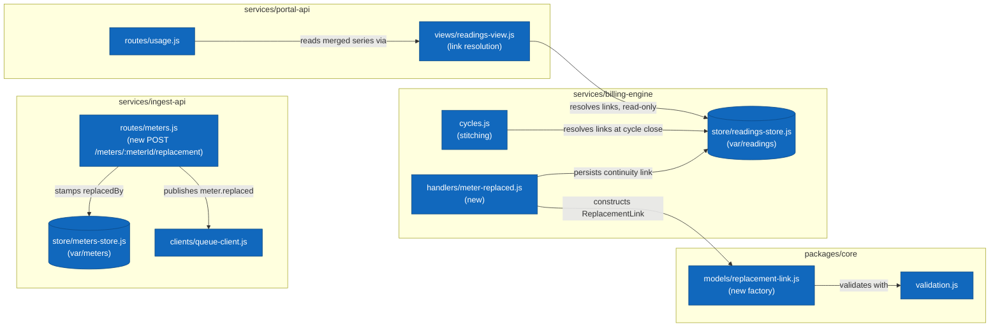

# Technical Considerations: Meter Replacement Continuity

## Solution Outline

The feature touches all four parts of the platform.

**Shared model (packages/core).** Add a ReplacementLink model (`src/models/replacement-link.js`) with a `createReplacementLink` factory validating `oldMeterId`, `newMeterId`, `customerId`, `swapReadingValue` (a non-negative register value), and `swappedAt`. The record carries `kind: 'continuity_link'` so stores and views can distinguish it from readings.

**Ingest API.** Add `POST /meters/:meterId/replacement` to the meter routes. The handler validates that both meters exist in the registry, stamps `replacedBy` on the original meter record in the meters store, and publishes a `meter.replaced` event through the queue client carrying old meter id, new meter id, customer id, swap reading value, and swap time. The ingest API performs no billing logic.

**Billing engine.** Add a `meter.replaced` handler that persists the continuity link. Continuity links live in the READINGS store, alongside the readings they stitch together — not in the invoices store (they are not billing output) and not in the meters store (the registry belongs to ingest, and billing never writes there). Cycle computation then resolves links for the customer: the old meter's in-window usage is extended from its last stored reading to `swapReadingValue`, the new meter contributes from its first post-swap reading, and the swap value is used exactly once as the boundary.

**Portal API.** The readings view resolves continuity links when assembling a customer's history: readings from the old and the new meter merge into one chronologically ordered series, and the usage payload exposes it as a single `series` array while keeping per-point meter attribution.

### Component Diagram

The components this change touches, inside their containers (box = component, cylinder = datastore; existing stores shown for orientation). Everything outside these boxes is out of scope for this feature.

## Risks

- **Double counting at the boundary.** The swap reading value appears in the link and potentially also as a final stored reading of the old meter. Cycle stitching must treat the link value as the authoritative boundary and never add both.
- **Idempotency.** `meter.replaced` can be redelivered; the handler must treat an existing link for the same meter pair as a no-op, like every other handler.
- **Orphan links.** A link whose new meter never produces readings must not break cycle close; the new meter simply contributes zero.
- **View cost.** The portal view resolves links on every read. Acceptable at current volumes; revisit if customers exceed a handful of swaps.

## Open Questions

- Should a replacement implicitly decommission the old meter in the registry, or is that a separate technician action?
- Does a mid-cycle tariff difference between old and new meter ever occur in practice? (Out of scope now; the new meter inherits the tariff.)
- Retention: do continuity links ever expire, or are they permanent supply-point history?
