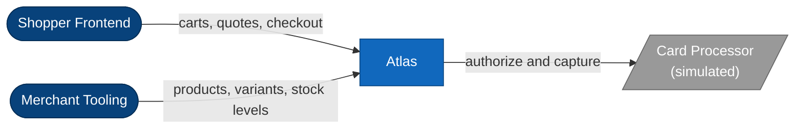
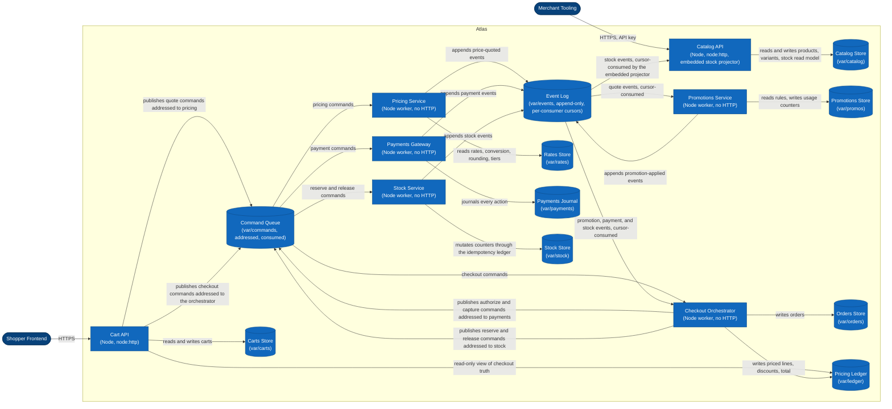

# Architecture: Atlas

## 1. Overview

Atlas is seven Node services and two shared libraries in a single repository. There are no npm dependencies and no external infrastructure: persistence is file-backed JSON, and commands and events travel between the services through the two shared queues. All state directories default to `var/` and are relocatable through `ATLAS_*` environment variables defined in the messaging package's configuration module.

## 2. Components and State Ownership

Every store and both queues have exactly one owner. Other services reach foreign state only through messages, or — for reading — through read-only views.

| Component             | Kind              | Owns                                                                                |
| --------------------- | ----------------- | ----------------------------------------------------------------------------------- |
| catalog-api           | HTTP service      | Catalog store (`var/catalog/`): products, variants, stock-level read model          |
| cart-api              | HTTP service      | Carts store (`var/carts/`)                                                          |
| pricing-service       | Background worker | Rates store (`var/rates/`): base prices, conversion table, rounding rules, tiers    |
| promotions-service    | Background worker | Promotions store (`var/promos/`): rules and per-customer usage counters             |
| checkout-orchestrator | Background worker | Orders store (`var/orders/`) and the pricing ledger (`var/ledger/`)                 |
| payments-gateway      | Background worker | Payments journal (`var/payments/`): journal entries and attempt records             |
| stock-service         | Background worker | Stock store (`var/stock/`): per-SKU counters and the reservation idempotency ledger |
| domain (package)      | Shared library    | Models, validation, integer-minor-unit money arithmetic                             |
| messaging (package)   | Shared library    | The command queue (`var/commands/`) and the event log (`var/events/`), config, ids  |

## 3. Catalog API

The catalog API serves products, variants, and stock levels over HTTP behind an API key. Products and variants are written through the API; the stock-level read model is derived state the catalog keeps current for itself so availability questions never cross a service boundary at read time. The authoritative stock counters live with the stock service.

## 4. Cart API

The cart API is the shopper-facing surface: carts are created in a chosen currency, lines are added and removed, and quoting and checkout are requested through it. The cart API owns only the carts store. Everything else it presents — quoted prices, discounts, checkout state — it surfaces through read-only views over state other services own; it never mutates that state and never computes platform truth of its own.

## 5. Pricing Service

The pricing service is a background worker owning the rates store: base prices (always in the store's single base currency), the per-currency conversion table, per-currency rounding rules, and per-SKU volume tiers. It consumes pricing commands and announces finished quotes as events. Pricing is pure data-in, data-out: the service holds no per-cart state.

## 6. Promotions Service

The promotions service is a background worker owning the promotions store: one record per rule, each carrying its type, type-specific parameters, declared stacking priority, validity window, and per-customer usage cap, plus the per-customer usage counters. It consumes quote events, decides which promotions participate, and announces the quote with its discount lines as a promotion-applied event.

## 7. Checkout Orchestrator

The checkout orchestrator is a background worker and the home of the checkout saga. It owns two stores: the orders store and the pricing ledger. The pricing ledger is the record of truth for what a cart's checkout costs — one record per cart, holding the priced lines, the discount lines, and the total, written only by the orchestrator. The saga coordinates payment authorization, stock reservation, and capture, creates the order record, and compensates on failure. A payment authorization that was obtained but never captured is left to lapse at the processor; there is no void call.

## 8. Payments Gateway

The payments gateway simulates the card processor. Authorization decisions are deterministic over amount and currency: per-currency bands recorded with the gateway's rules decide approval and the machine-readable decline codes. Every action — authorization, decline, capture — lands as an entry in the payments journal. The simulated processor executes what it is instructed to; deduplicating instructions is the platform's responsibility.

## 9. Stock Service

The stock service owns the per-SKU stock counters: on-hand and reserved, with availability always derived, never stored. Reservations are all-or-nothing across an order's lines. Alongside the counters it keeps a per-order idempotency ledger: every mutation records a key first, and a redelivered instruction finds the key and replays its recorded outcome — announcing it again for consumers that missed it — instead of mutating twice.

## 10. Cross-Service Communication

Commands and events travel between the services through the two shared queues. The command queue (`var/commands/`) carries imperative, addressed instructions: each command names the one service that must act on it, and taking a command removes it. The event log (`var/events/`) carries facts: events are never removed by consumption, and each consuming service advances its own cursor through the log, so several services can react to the same fact independently and a crashed consumer resumes where it left off. Delivery is effectively at-least-once on both paths; handlers are expected to be idempotent.

## 11. Configuration and Operations

The messaging package's configuration module is the single source of configuration: every store directory, queue directory, port, API key, and poll interval is overridable by environment variable, which is also how the test suite relocates all state into per-test temp directories. Each service starts from its own `bin/start.js` and runs independently; the filesystem carries all durable state, so no startup ordering is required. The HTTP services' health endpoints are unauthenticated for load-balancer probes.

## 12. Diagrams (C4)

The diagrams below are the same system as the prose above, at two zoom levels. Shapes and colors follow the C4 styling convention: rounded box = person/actor, box = container, cylinder = datastore or queue, trapezoid = external system.

### Context

### Container

The messaging roles, stated exactly: the two HTTP services never consume a queue — the cart API only publishes commands (quoting to the pricing service, checkout to the orchestrator) and reads checkout truth through its read-only view of the pricing ledger, while the catalog API's embedded projector cursor-consumes stock events to keep its read model current. The pricing service, promotions service, payments gateway, and stock service each consume only commands or events meant for them and announce results on the event log. The checkout orchestrator is the only service that both consumes the event log broadly and publishes commands onward (payments, stock). Commands are removed when taken; events are never removed — each consumer advances its own cursor. `packages/domain` and `packages/messaging` are libraries linked into every service, not deployable containers, so they do not appear at this zoom level.
