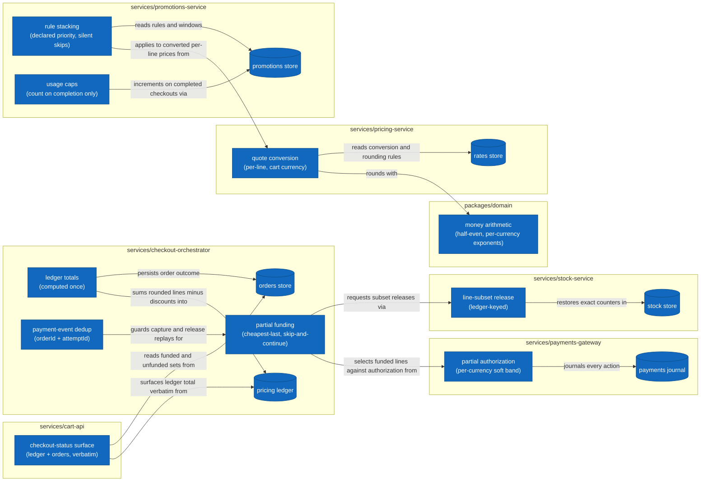

# Technical Considerations 001: Multi-Currency Checkout with Stacked Promotions and Partial Payment Capture

## Where the Behavior Lands

This feature is a cross-cutting change: no single service can implement it alone, and several of today's behaviors are intentionally superseded.

- **Pricing.** Quoting must become currency-aware: today quotes are issued in the rates store's base currency regardless of the cart's currency. The conversion table and the per-currency rounding rules already live in the rates store as data; the quoting path must start consulting them, converting and rounding each line (and each unit price) separately, after volume tiers are applied in the base currency. The conversion arithmetic must stay in integers end to end — the shared money helpers provide half-even integer division; no floating point may touch an amount.
- **Promotions.** Application must become rule-respecting: ordering by declared priority (today it is store listing order), percentage computed per converted line (today on the subtotal), the buy-N-get-M type implemented (today unimplemented types are skipped with a warning), validity windows enforced against the quote time, and caps enforced against the per-customer usage counters. Usage counting must MOVE: today a use is recorded the moment a discount lands on a quote; it must instead be recorded exactly once when a checkout completes, which means the promotions side must learn about completed checkouts — confirmed and partially confirmed alike — and must not count declined ones.
- **Payments.** The gateway's middle band changes meaning: between the soft and hard ceilings it currently declines in full; it must instead authorize exactly the soft-band amount and report the shortfall. Journal and attempt records must reflect the actually-authorized amount, since the capture is validated against it.
- **Checkout orchestration.** The saga grows a partial-confirmation branch: when the authorized amount is short of the ledger total, it must compute the funded/unfunded split (the cheapest-last walk defined in the spec), capture the funded sum, release only the unfunded lines' reservations, and persist the order as partially confirmed with both line sets. The orchestrator must also become robust to redelivered payment events: processing is keyed on order + attempt identity, so a duplicate neither re-captures nor re-releases. The ledger total remains computed once, here, and nowhere else.
- **Stock.** Release must support a subset of a reservation: today release returns the full recorded reservation. Partial releases must restore exact counts and be idempotent under redelivery, keyed in the same ledger that guards reservations.
- **Cart API.** A new read surface exposes checkout status (status, funded/unfunded line sets, total, currency) assembled from read-only views over the pricing ledger and the orders store. The surfaced total must be the ledger total verbatim — the cart API's habit of recomputing totals from lines must not leak into this surface.
- **Catalog.** No new behavior expected: the stock read model already projects reservations and releases; it must simply end up exact once the partial flow's events are all consumed.

### Component Diagram

The feature's touch points at component zoom, inside their containers (box = component, cylinder = datastore; existing pieces shown for orientation). Everything outside these boxes is out of scope.

## State

No new stores. New facts live in existing ones: the funded/unfunded split on the order record (orders store), the actually-authorized amount on the attempt (payments journal), partial-release entries in the stock service's idempotency ledger, and usage counters (promotions store) now driven by checkout completion instead of quoting.

## Risks

- **Rounding seams.** The per-line rounding contract interacts with the percentage-per-line contract: both round half-even at the line level, and mixing levels (rounding a subtotal anywhere) produces off-by-one totals that only surface with adversarial amounts. Exact integer fixtures in tests are the guard.
- **Event-driven cap timing.** Counting usage on completion couples promotions to the checkout outcome events. Double-consumption (a redelivered completion event) or counting on the wrong outcome (declined) silently corrupts caps.
- **Partial-path compensation ordering.** Capture and release both hang off the same authorization event. If release precedes the funded-set computation, or the funded walk uses pre-conversion amounts, stock and money disagree with the persisted order.
- **Idempotency scope.** The stock service's ledger currently keys one reserve and one release per order; the partial flow must not let a full-release key swallow a partial release (or vice versa).

## Open Questions

- Should the unfunded remainder of a partially confirmed order be re-attemptable (a second payment attempt for the unfunded lines)? Out of scope now; the attempt identity scheme should not preclude it.
- Should buy-N-get-M support unit-level (not line-level) counting? The spec fixes line-level; merchandising may ask for units later.
- Rates are read at quote time; a checkout against a stale quote is accepted by design. Do we need a quote expiry?
