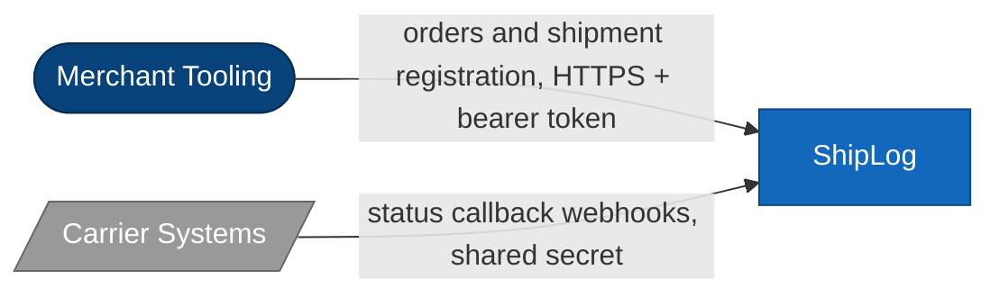
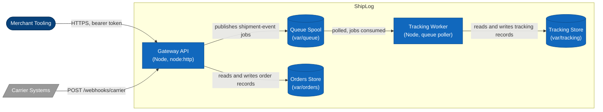

# Architecture: ShipLog

## 1. Stack

- Language: plain CommonJS JavaScript, no transpilation.
- Runtime: Node.js 22 (LTS); only `node:` built-in modules are used.
- Dependencies: none. The platform has zero npm dependencies by policy; HTTP is served with `node:http`, persistence and queueing use `node:fs`.
- Testing: `node:test` with `node:assert`, run via `npm test`.

## 2. Services and Shared Code

The platform is two long-running services plus one shared library:

| Component       | Path                        | Responsibility                                                                         |
| --------------- | --------------------------- | -------------------------------------------------------------------------------------- |
| Gateway API     | `services/gateway-api/`     | Public HTTP API: order intake, shipment registration, carrier webhooks, health.        |
| Tracking worker | `services/tracking-worker/` | Background processing of shipment events; owns tracking history and its state machine. |
| Shared library  | `packages/shared/`          | Domain models, validation, configuration, id/clock utilities, and the job queue.       |

Shipment events flow between the gateway and the tracking worker via the shared queue (`packages/shared/src/queue/in-memory-queue.js`). The queue is the only integration point between the two services; they never call each other over HTTP and never read each other's code.

## 3. Data & Persistence

All state is file-backed JSON. There are two distinct datastores with different owners, plus the queue's spool:

- **Orders store** (`var/orders/`, implemented in `services/gateway-api/src/store/orders-store.js`). One JSON file per order. Holds order records: customer contact, line items, shipping address, order status, and the ids of shipments registered against the order. Owned by the gateway.
- **Tracking store** (`var/tracking/`, implemented in `services/tracking-worker/src/store/tracking-store.js`). One JSON file per shipment. Holds tracking records: current shipment status, status timestamps, and the append-only tracking event history. Owned by the tracking worker. Anything derived from tracking events belongs here, not in the orders store.
- **Queue spool** (`var/queue/`). One JSON file per pending job; a job file is removed when consumed. Durable across restarts.

All writes in both stores are atomic (temp file + rename). Store directories are configurable through `SHIPLOG_*` environment variables (`packages/shared/src/config.js`), which is also how tests isolate state.

## 4. Infrastructure

- Each service is a plain Node process with a `bin/start.js` entrypoint; there is no container or orchestrator requirement.
- The gateway listens on a single port (`SHIPLOG_GATEWAY_PORT`, default 8080).
- The tracking worker is not network-reachable; it polls the queue spool on an interval (`SHIPLOG_WORKER_POLL_MS`).
- Both processes must share a filesystem for `var/` — the queue and datastores are directories, not network services.

## 5. External Services

- **Carriers** are the only external integration: they deliver status callbacks to `POST /webhooks/carrier`, authenticated with a shared secret header (`x-shiplog-webhook-secret`). ShipLog never calls out to carrier APIs.
- API clients (merchant tooling, storefronts) authenticate with a static bearer token (`SHIPLOG_API_TOKEN`).
- There is no database server, message broker, or email provider; a decommissioned email notification path survives only as legacy code.

## 6. Observability

- `GET /health` is unauthenticated and reports service status and uptime for load-balancer probes.
- The gateway writes one access-log line per request (method, path, status, duration).
- The worker logs per-job retry warnings and permanent failures; retries use in-process exponential backoff (`services/tracking-worker/src/retry.js`).
- There is no metrics or tracing stack; logs are the only telemetry.

## 7. Diagrams (C4)

The diagrams below are the same system as the prose above, at two zoom levels. Shapes and colors follow the C4 styling convention: rounded box = person, box = container, cylinder = datastore, trapezoid = external system.

### Context

### Container

The queue is one-directional: only the gateway publishes, only the worker consumes. `packages/shared` is a library linked into both services, not a deployable container, so it does not appear at this zoom level.
