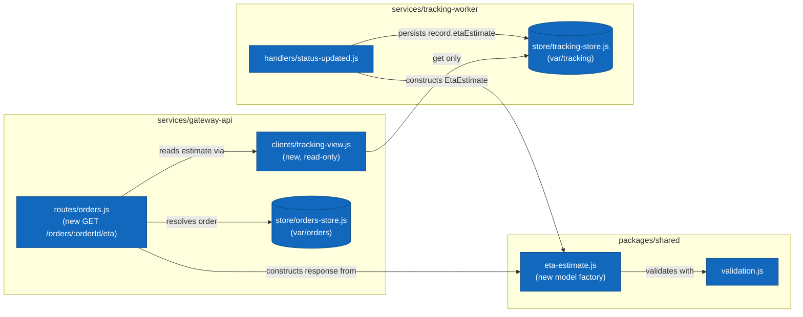

# Technical Considerations: Delivery ETA

## Proposed Solution

The feature touches all three containers, each in a small and characteristic way.

### Shared library (`packages/shared`)

Add an `EtaEstimate` model at `packages/shared/src/models/eta-estimate.js` following the existing model conventions (factory function, validation via `packages/shared/src/validation.js`). Fields: `shipmentId`, `etaIso`, `confidence` (validated into `[0, 1]`), `computedAt`. Both services construct and read estimates through this one factory so the shape can never drift between writer and reader.

### Tracking worker (`services/tracking-worker`)

The `status-updated` handler is the natural computation point: it already loads the tracking record, applies the transition, and appends the event. After the transition succeeds, compute the estimate from the data in hand — current status, the event history's timing, and the carrier — and set it as `record.etaEstimate` before the single `trackingStore.save(record)` call. A simple heuristic is sufficient for the first release (e.g. baseline transit duration per carrier, tightened as the shipment advances through `in_transit` and `out_for_delivery`, with confidence rising at each stage). Reprocessing a status update overwrites the previous estimate, keeping the handler idempotent.

Estimates are tracking-derived data, so they persist in the tracking store with the record they derive from. The orders store is not involved; writing estimates there would split ownership of shipment-derived state across two services' datastores.

### Gateway API (`services/gateway-api`)

Add `GET /orders/:orderId/eta`. The handler resolves the order from the orders store, then needs the tracking record for the order's shipment — which today the gateway cannot reach, since tracking data has no read path outside the worker. Introduce a read-only tracking view in the gateway (a thin store opened on the tracking data directory, exposing `get` only) and wire the tracking data directory into `createGatewayServer` as a new `trackingDir` option. The route reads the shipment's `etaEstimate` and serializes `{ orderId, etaIso, confidence }`; a missing estimate is a `404`-adjacent decision to settle during implementation (spec says the happy path assumes tracking data exists).

### Component Diagram

The components this change touches, inside their containers (box = component, cylinder = datastore; the two existing stores are shown for orientation). Everything outside these boxes is out of scope for this feature.

## Risks

- **Cross-store read coupling.** The gateway reading tracking files makes deploy-time filesystem sharing between the two services load-bearing for an API response, not just for eventual consistency. Acceptable for the current single-host deployment; revisit if the services ever split hosts.
- **Estimate staleness.** Estimates refresh only on status updates; a shipment that stops reporting keeps an aging ETA. The `computedAt` field exists so consumers can judge staleness.
- **Heuristic quality.** A per-carrier baseline will be wrong for edge routes. Confidence exists to communicate exactly this; the heuristic can improve without any contract change.
- **Orders with multiple shipments.** The endpoint promises one ETA per order; with several shipments the natural first answer is the latest ETA among them. The spec's acceptance tests exercise single-shipment orders only.

## Open Questions

- Should an order whose shipments have no estimate yet answer `404` or `200` with a null body? Leaning `404` to keep the payload contract strict.
- Does the first release need per-carrier baselines configurable, or are hardcoded defaults acceptable? Defaulting to hardcoded.
